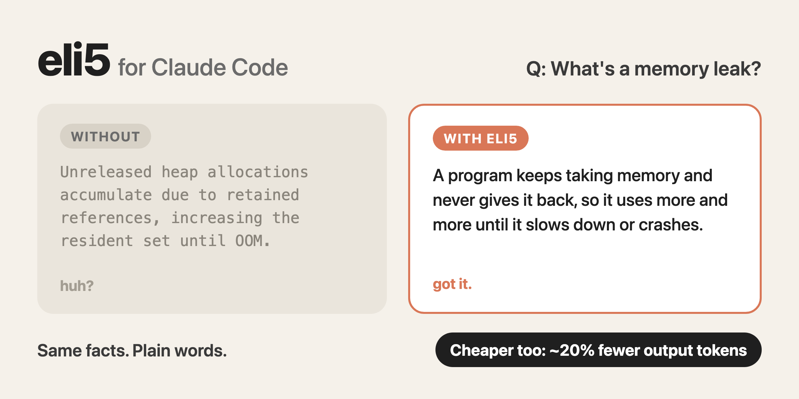

# eli5

Claude Code answers you understand on the first read.



ELI5 is an always-on mode for Claude Code. It puts the core idea first, uses plain words, defines jargon the first time it shows up, and keeps code, paths and error messages exact. It aims for clarity, not shortness, and it is not baby talk: nothing gets less accurate. As a bonus it saves money: answers use about 20% fewer output tokens ([details](#token-use-it-saves-money)).

## Install

```sh
claude plugin marketplace add 609NFT/eli5 && claude plugin install eli5@eli5
```

Or inside Claude Code: `/plugin marketplace add 609NFT/eli5`, then `/plugin install eli5@eli5`.

It turns on in your next session.

## Use

| You say | What happens |
| --- | --- |
| nothing | On in every session |
| `normal mode` or `/eli5 off` | Off for the rest of this session |
| `eli5` or `/eli5` | Back on |
| `/eli5 what is a mutex` | That question, answered ELI5 style |
| `claude plugin disable eli5@eli5` | Off for good (`enable` brings it back) |

Ask for a diagram or visual explainer and you get one self-contained HTML page built on the same rules.

## The rules

1. Core idea first, in 1-2 sentences.
2. Plain words, short sentences.
3. Define jargon on first use.
4. One analogy at most, only if it helps.
5. Never trade accuracy for simplicity.
6. Code, commands, paths, errors and numbers stay exact.
7. Short structure: small paragraphs, bullets, numbered steps.
8. No filler.

The full text is [skills/eli5/SKILL.md](skills/eli5/SKILL.md).

## Example

> **What's a memory leak?**
>
> Without: "Unreleased heap allocations accumulate due to retained references, increasing the resident set until OOM."
>
> With: "A memory leak is when a program keeps taking memory and never gives it back, so it uses more and more until it slows down or crashes. It usually happens because the code still holds a reference (a pointer to the data) it no longer needs, so the memory can't be freed."

## Token use: it saves money

**ELI5 makes each answer cheaper, even though it uses slightly more tokens in total.** Answers come out about 20% shorter, and output tokens are the expensive ones.

| Per answer, on average | Without | With | Change |
| --- | --- | --- | --- |
| Output tokens | 773 | 622 | -151 (-20%) |
| Input tokens | 4,598 | 5,504 | +906 |
| Words in the answer | 323 | 270 | -16% |

Why 151 fewer output tokens beat 906 more input tokens:

- **Output costs 5x more than input.** On Sonnet 5.5 it's $10 per million output tokens and $2 per million input.
- **The extra input is cached.** Those ~900 tokens are the ELI5 rules, the same every turn, so after the first turn they're read from cache at $0.20 per million, a tenth of the normal input price.
- **The math, per answer on Sonnet 5.5:** 151 fewer output tokens save $0.0015, and 906 cached input tokens cost $0.0002. You keep about $0.0013 per answer, or 88% of the output savings. Caching the rules the first time costs about $0.004, which the savings cover by the third answer.

Where it saves less: the 20% was measured on questions and explanations. In coding sessions most tokens are code and tool calls, which ELI5 doesn't shorten, so expect a smaller saving there.

How it was measured: 12 everyday coding questions (concepts, error messages, how-tos), each run twice with and twice without the plugin, through `claude -p` on Sonnet 5.5 with tools off, on 2026-10-29. Prices are Anthropic's API list prices. Results will differ by model and by the kind of question.

## How it works

Two files:

- [skills/eli5/SKILL.md](skills/eli5/SKILL.md) holds the rules and the on/off switch.
- [hooks/hooks.json](hooks/hooks.json) is a SessionStart hook that loads those rules into every session (about 900 tokens), so you never have to ask for it.

Inspired by [caveman](https://github.com/JuliusBrussee/caveman), which goes for fewer words. This goes for clearer ones.

## License

MIT
